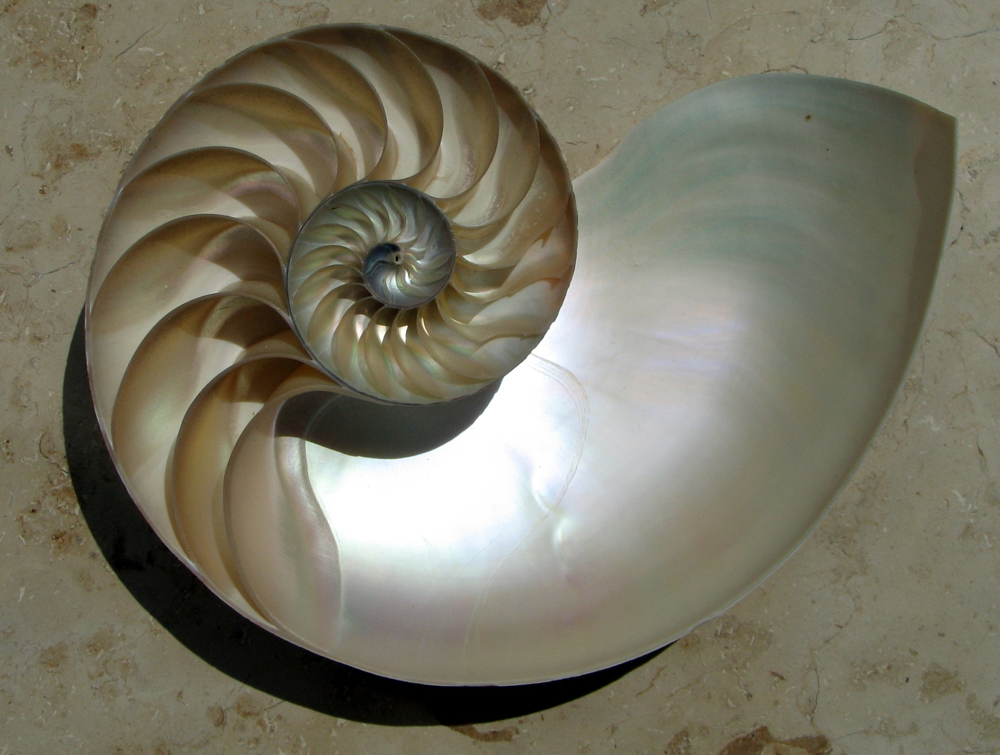
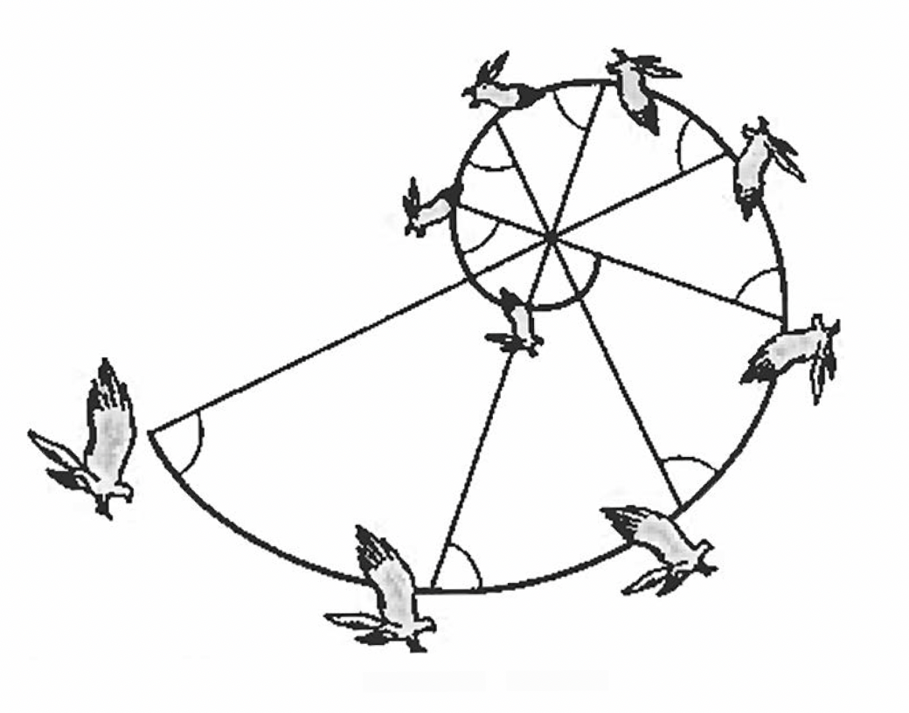

```{r}
#| echo: false
#| output: false

library(Statamarkdown)

library(ggplot2)

library(gganimate)

```

:::{.story-scroll-hint}
Scroll to explore 
`r emo::ji("down_arrow")`
:::

:::{.cr-section}
:::{focus-on="cr-exponential"}
## The Exponential Function

We start with the *exponential function*.
:::

:::{#cr-exponential .scale-to-fill}
$$\color{purple}{y} \color{black}{=} \color{blue}{\text{base}}^{\color{red}{\text{exponent}}}$$
:::

:::{focus-on="cr-exponential-definition"}
The *exponent* tells us how many times to multiply the base by itself to get the result. 
:::

:::{#cr-exponential-definition .scale-to-fill}
$\color{blue}{2}^{\color{red}{3}} \color{black}{=} \color{purple}8$ 

because 

$\color{blue}{2} \times \color{blue}{2} \times \color{blue}{2} \color{black}{=} \color{purple}{8}$
:::

:::{focus-on="cr-logarithm-if"}
## The Logarithm

We then consider the *logarithm*. 
:::

:::{#cr-logarithm-if .scale-to-fill}
If... 

$$\color{purple}{y} \color{black}{=} \color{blue}{b}^{\color{red}{x}}$$
:::

:::{focus-on="cr-logarithm-then"}
:arrow_down:
:::

:::{#cr-logarithm-then .scale-to-fill}
Then... $$\log_{\color{blue}{b}}{\color{purple}{y}} \color{black}{=} \color{red}{x}$$
:::

:::{focus-on="cr-logarithm-words"}
In words:
:::

:::{#cr-logarithm-words .scale-to-fill}
If $\color{purple}{\text{number}} = \color{blue}{\text{base}}^{\color{red}{\text{exponent}}}$ 

then 

$\log_{\color{blue}{\text{base}}}{\color{purple}{\text{number}}} = \color{red}{\text{exponent}}$ 
:::

:::{focus-on="cr-logarithm-example"}
For example: 
:::

:::{#cr-logarithm-example .scale-to-fill}
$\color{blue}{2}^{\color{red}{3}} = \color{purple}{8}$

therefore 

$log_{\color{blue}{2}} \color{purple}{8} = \color{red}{3}$
:::

:::{focus-on="cr-logarithm-question"}
The logarithm answers the question: *What is the power to which we have to raise the number to get the result?* 
:::

:::{#cr-logarithm-question .scale-to-fill}
::: {.callout-tip}
### Key Idea
The logarithm may thus be thought of as *the inverse of the exponential function*. 
:::
:::

:::{focus-on="cr-e-definition"}
## The Natural Logarithm

For deep mathematical reasons, it is often useful to use logarithms with base $e$[^pi] which is often termed the *natural logarithm*, written $\ln$
:::

:::{#cr-e-definition .scale-to-fill}
::: {.callout-tip}
### e

$e$ is a kind of fundamental mathematical constant, like $\pi$. 
:::
:::
 
[^pi]: $e$ does not have the easy geometric definition that $\pi$ has. <p> For any $\bigcirc$, $$\pi = \frac{\text{circumference}}{\text{diameter}}$$.

$e$ emerges in many contexts, including some aspects of compound growth processes[^e]. $e$ is approximately equal to 2.71828....

[^e]: A common definition of $e$--grounded in ideas of compound growth--is $$e = \lim_{n \to \infty} \left(1 + \frac{1}{n} \right)^n$$

:::{focus-on="cr-ln-definition-if"}
:arrow_down:
:::

:::{#cr-ln-definition-if .scale-to-fill}
If 

$$\color{purple}{y} = \color{blue}{e}^{\color{red}{x}}$$ 
:::

:::{focus-on="cr-ln-definition-then"}
:arrow_down:
:::

:::{#cr-ln-definition-then .scale-to-fill}
Then 

$$\ln{\color{purple}{y}} = \color{red}{x}$$
:::

:::{focus-on="cr-probability"}
## Logistic Regression

One application of the logarithm is in thinking about *logistic regression*. In logistic regression, we start by thinking about the *probability* of our outcome: 
:::

:::{#cr-probability .scale-to-fill}
$$p(\text{outcome})$$
:::

:::{focus-on="cr-odds"}
We move to thinking about the *odds* of our outcome: the *probability* that our outcome will occur weighed against the *probability* that our outcome will not occur.
:::

:::{#cr-odds .scale-to-fill}
$$\frac{p(\text{outcome})}{1-p(\text{outcome})}$$
:::

:::{focus-on="cr-log-odds"}
For mathematical reasons--illustrated below--we end up working with the *logarithm* of the odds, or the *log odds*:
:::

:::{#cr-log-odds .scale-to-fill}
$$\ln(\frac{p(\text{outcome})}{1-p(\text{outcome})}) = \beta_0 + \beta x$$
:::

:::{focus-on="cr-solve-for-y"}
To *graph* or *visualize* these *log odds*, we need to solve for $p(\text{outcome})$, the *probability* of the outcome:
:::

:::{#cr-solve-for-y .scale-to-fill}
$$p(\text{outcome}) = \frac{e^{\beta_0 + \beta x}}{1 + e^{\beta_0 + \beta x}}$$
:::

:::{focus-on="cr-sigmoid"}
This function is sometimes called a *sigmoid*, and has the interesting property of mapping the interval $- \infty < x < \infty$ to $0 < \text{probability} < 1$. 

This is the first step in mapping a set of *continuous* predictors to the probability of a *categorical* outcome.
:::

:::{#cr-sigmoid .scale-to-fill}
```{r}
#| echo: false
#| output: true
#| message: false
#| warning: false

x2 <- seq(-10, 10, .5)

y2 <- exp(x2)/(1 + exp(x2))

mydata2 <- data.frame(x2, y2)

p_logistic_sigmoid <- ggplot(mydata2,
       aes(x = x2,
           y = y2)) +
  geom_point(color = "darkorange",
             size = 3) +
  labs(title = "Logistic or Sigmoid Function",
       x = "x",
       y = "probablity") +
  theme_void()
  
p_logistic_sigmoid_anim <- p_logistic_sigmoid +
  transition_manual(x2, cumulative = TRUE)

animate(p_logistic_sigmoid_anim, 
        nframes = 41,
        renderer = gifski_renderer(loop = FALSE))

```
:::


:::{focus-on="cr-logarithmic-spiral"}
## Logarithmic Spiral

An interesting sidenote is that the logarithm forms the basis of the logarithmic spiral. The equation for a logarithmic spiral in polar coordinates is: $r = ae^{b \theta}$, where $\theta$ is the angle, $r$ is the radius, and $a$ and $b$ are constants. 
:::

:::{#cr-logarithmic-spiral .scale-to-fill}
::: {layout-ncol=1}

```{r}
#| echo: false
#| output: true
#| message: false
#| warning: false

x1 <- seq(1, 10, .1)

y1 <- .05 * exp(.05 * x1)

mydata <- data.frame(x1, y1)

p_logarithmic_spiral <- ggplot(data = mydata,
       aes(x = x1,
           y = y1, 
           group = x1)) +
  geom_point(color = "darkred", 
             size = 3) +
  # geom_smooth() +
  coord_polar(theta = "x") +
  labs(title = "Logarithmic Spiral") +
  # transition_reveal(x) +
  theme_void()

p_logarithmic_spiral_anim <- p_logarithmic_spiral +
  transition_manual(x1, cumulative = TRUE)

animate(p_logarithmic_spiral_anim, 
        nframes = 91,
        renderer = gifski_renderer(loop = FALSE))

```

:::
:::

:::{focus-on="cr-logarithmic-spiral-2"}
Logarithmic spirals can be found in nature in the *nautilus shell*, and in *sunflowers* and in the *flight of hawks*.
:::

:::{#cr-logarithmic-spiral-2 .scale-to-fill}
::: {layout-ncol=3}




:::
:::

:::

